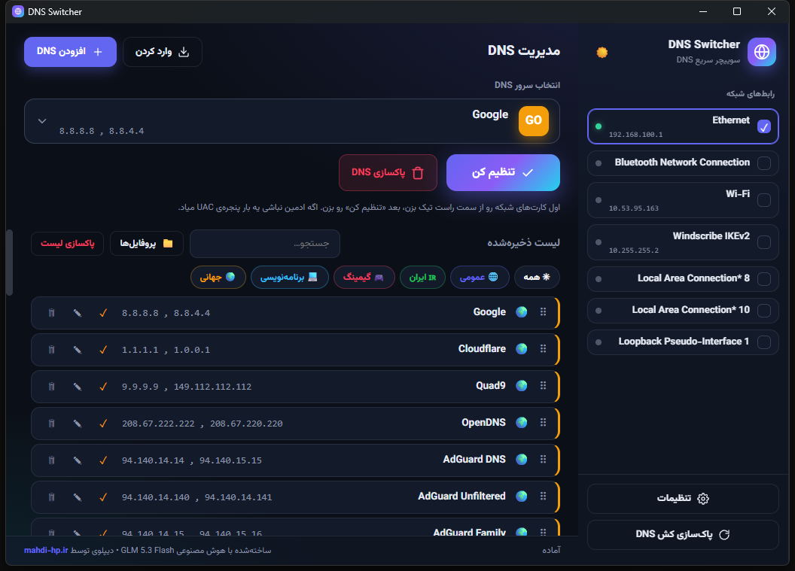

# 🌐 DNS Switcher

<div dir="rtl">

**سوییچر سریع و مدرن DNS برای ویندوز** — با پروفایل‌های آماده، مرتب‌سازی کشیدنی
(Drag & Drop)، رنگ اختصاصی برای هر پروفایل و تنظیمات ظاهری کامل.

ساخته‌شده با **Rust + Tauri 2** — یک فایل اجرایی سبک، بدون وابستگی سنگین.

</div>



<div align="center">


</div>

---

<div dir="rtl">

## ✨ ویژگی‌ها

- 🚀 **اعمال یک‌کلیکی DNS** روی چند کارت شبکه به‌صورت هم‌زمان
- 🗂️ **پروفایل‌ها** — عمومی، ایران، گیمینگ، برنامه‌نویسی و پروفایل‌های دلخواه
- 🎨 **رنگ اختصاصی هر پروفایل** در کنار نام آن
- ↔️ **مرتب‌سازی دلخواه** لیست DNS با کشیدن ردیف‌ها
- 📥 **ورود از فایل‌های `.bat`** — پارس خودکار دستورهای `netsh`
- 🔍 **جستجوی زنده** در لیست ذخیره‌شده
- 🌙 **ظاهر تاریک/روشن** با رنگ اصلی، رنگ متن، اندازه و فونت قابل تغییر
- 🔤 فونت **وزیرمتن** و رابط کاربری کاملاً **فارسی و راست‌به‌چپ**
- 🧹 **پاکسازی DNS** و **Flush DNS** با یک کلیک
- 🖥️ نمایش کارت‌های شبکهٔ **مخفی و مجازی** هم در لیست
- 🛡️ **بدون نیاز به ادمین برای نصب** — فقط لحظهٔ اعمال DNS یک پنجرهٔ UAC می‌آید
- 📦 فقط **یک فایل اجرایی ~۳ مگابایتی** بدون هیچ نصبی در رجیستری (نسخهٔ پرتابل)

---

## ⬇️ دانلود و نصب

آخرین نسخه از بخش **Releases** همین مخزن یا از سایت [mahdi-hp.ir](https://mahdi-hp.ir) قابل دریافت است.

| فایل | توضیح | حجم |
|------|-------|-----|
| `DNS-Switcher-Setup-1.1.0.exe` | نصب‌کنندهٔ استاندارد ویندوز (NSIS) — **پیشنهادشده** | ~۱٫۳ مگابایت |
| `DNS-Switcher-Portable-1.1.0.exe` | نسخهٔ پرتابل — بدون نصب، فقط اجرا | ~۳ مگابایت |

> 💡 نسخهٔ پرتابل برای اجرا از روی فلش‌مموری یا پوشهٔ دلخواه عالی است.
> نصب‌کننده در پوشهٔ کاربر جاری نصب می‌شود، پس **نیازی به دسترسی ادمین ندارد**.

### 🧩 پیش‌نیاز

- **ویندوز ۱۰ یا ۱۱ (۶۴ بیتی)**
- **Microsoft Edge WebView2 Runtime** — روی ویندوزهای به‌روز به‌صورت پیش‌فرض موجود است.
  (اگر نبود، نصب‌کننده خودش آن را دریافت می‌کند.)

---

## 🛠️ ساخت از سورس

### پیش‌نیازهای توسعه

| ابزار | نسخه |
|-------|------|
| [Rust](https://rustup.rs) | 1.77 یا بالاتر (`x86_64-pc-windows-msvc`) |
| **MSVC Build Tools** + Windows SDK | برای لینک کردن روی ویندوز |
| [Node.js](https://nodejs.org) | ۱۸ یا بالاتر (فقط برای Tauri CLI و ساخت آیکون) |
| WebView2 Runtime | روی ویندوز ۱۰/۱۱ موجود است |

### اجرا در حالت توسعه

```bash
npm install
npm run dev        # = tauri dev
```

معادل دستی بدون Node:

```bash
cargo run --manifest-path src-tauri/Cargo.toml
```

### ساخت نسخهٔ نهایی (Installer + Portable)

```bash
npm run build      # = tauri build
```

خروجی‌ها:

```text
src-tauri/target/release/dns-switcher.exe                        ← نسخهٔ پرتابل (همین فایل را کپی کنید)
src-tauri/target/release/bundle/nsis/DNS Switcher_1.1.0_x64-setup.exe   ← نصب‌کننده
```

> ℹ️ در Tauri فقط بسته‌های `nsis` و `msi` ساخته می‌شوند؛ «پرتابل» همان فایل
> خام `dns-switcher.exe` است که بدون نصب اجرا می‌شود.

### تست‌ها

```bash
npm test           # = cargo test --manifest-path src-tauri/Cargo.toml
```

پوشش تست‌ها: پارس فایل `.bat`، ساخت لیست پیش‌فرض (Curated Seed)، مدیریت پروفایل‌ها،
CRUD لیست DNS، مرتب‌سازی، پاک‌سازی و ادغام تنظیمات.

### ساخت مجدد آیکون

```bash
npm run icon       # = node make-icon.js
```

آیکون از روی نشان برند (لوگوی کنار نام برنامه در سایدبار) تولید می‌شود و در هر دو
مسیر `assets/` و `src-tauri/icons/` نوشته می‌شود.

---

## 📁 ساختار پروژه

```text
.
├── renderer/                  # رابط کاربری (HTML/CSS/JS خالص — بدون فریم‌ورک)
│   ├── index.html             #   ساختار صفحه (fa / rtl)
│   ├── styles.css             #   تم، متغیرهای رنگ و انیمیشن‌ها
│   ├── app.js                 #   منطق UI و اتصال به window.api
│   └── fonts/                 #   فونت وزیرمتن (woff2)
│
├── src-tauri/                 # هستهٔ برنامه با Rust
│   ├── src/
│   │   ├── main.rs            #   نقطهٔ ورود باینری
│   │   ├── lib.rs             #   راه‌اندازی Tauri، پلاگین‌ها و ساخت پنجره
│   │   ├── commands/          #   دستورهای IPC (DNS / Store / App)
│   │   ├── dns_service/       #   اجرای netsh و PowerShell، Elevation، اعتبارسنجی IP
│   │   └── store/             #   ذخیره‌سازی JSON، پروفایل‌ها، پارس .bat، Seed
│   ├── tests/store_crud.rs    #   تست یکپارچه‌سازی لایهٔ ذخیره‌سازی
│   ├── capabilities/          #   مجوزهای امنیتی Tauri
│   ├── icons/                 #   آیکون‌های اپ (ico/png)
│   ├── tauri-bridge.js        #   پل سازگاری: window.api → __TAURI__.core.invoke
│   └── tauri.conf.json        #   پیکربندی Tauri
│
├── assets/                    # آیکون‌های منبع (ico/png)
├── docs/screenshot.png        # تصویر برنامه برای README
├── make-icon.js               # سازندهٔ آیکون از روی نشان برند
└── package.json               # اسکریپت‌های dev / build / test / icon
```

---

## 🧠 معماری

رابط کاربری **بدون هیچ تغییری** از نسخهٔ قبلی منتقل شده است و صرفاً از طریق
`window.api` با هستهٔ Rust حرف می‌زند. فایل `src-tauri/tauri-bridge.js` همان
قرارداد قبلی را با `invoke` تزریق می‌کند، بنابراین کد `renderer/` دست‌نخورده مانده است.

```text
renderer/app.js  →  window.api.*  →  tauri-bridge.js  →  Rust #[tauri::command]
                                                              ↓
                                                   store/*  +  dns_service/*
```

### 📍 محل ذخیرهٔ داده‌ها

پس از نصب، داده‌های هر کاربر جداگانه ذخیره می‌شود:

```text
%APPDATA%\DNS Switcher\data\
├── dns-list.json      # لیست DNSهای ذخیره‌شده
├── profiles.json      # پروفایل‌ها و رنگ‌ها
└── settings.json      # تنظیمات ظاهری
```

> 🔐 برنامه هیچ داده‌ای را به بیرون ارسال نمی‌کند. همه‌چیز روی همین سیستم می‌ماند.

---

## 🧰 پشتهٔ فناوری

- **Rust** — منطق برنامه و اجرای دستورهای سیستمی
- **Tauri 2** — پوستهٔ دسکتاپ و پل IPC
- **HTML / CSS / JavaScript خالص** — رابط کاربری، بدون فریم‌ورک
- **PowerShell + netsh** — کوئری کارت‌های شبکه و تغییر DNS
- **NSIS** — بسته‌بندی نصب‌کننده

---

## 📄 مجوز

این پروژه تحت مجوز **MIT** منتشر شده است — جزئیات در فایل [LICENSE](./LICENSE).

<div align="center">

ساخته‌شده با ❤️ توسط **MahdiDev**

[mahdi-hp.ir](https://mahdi-hp.ir) · [github.com/MahdiHpg](https://github.com/MahdiHpg)

</div>

</div>
